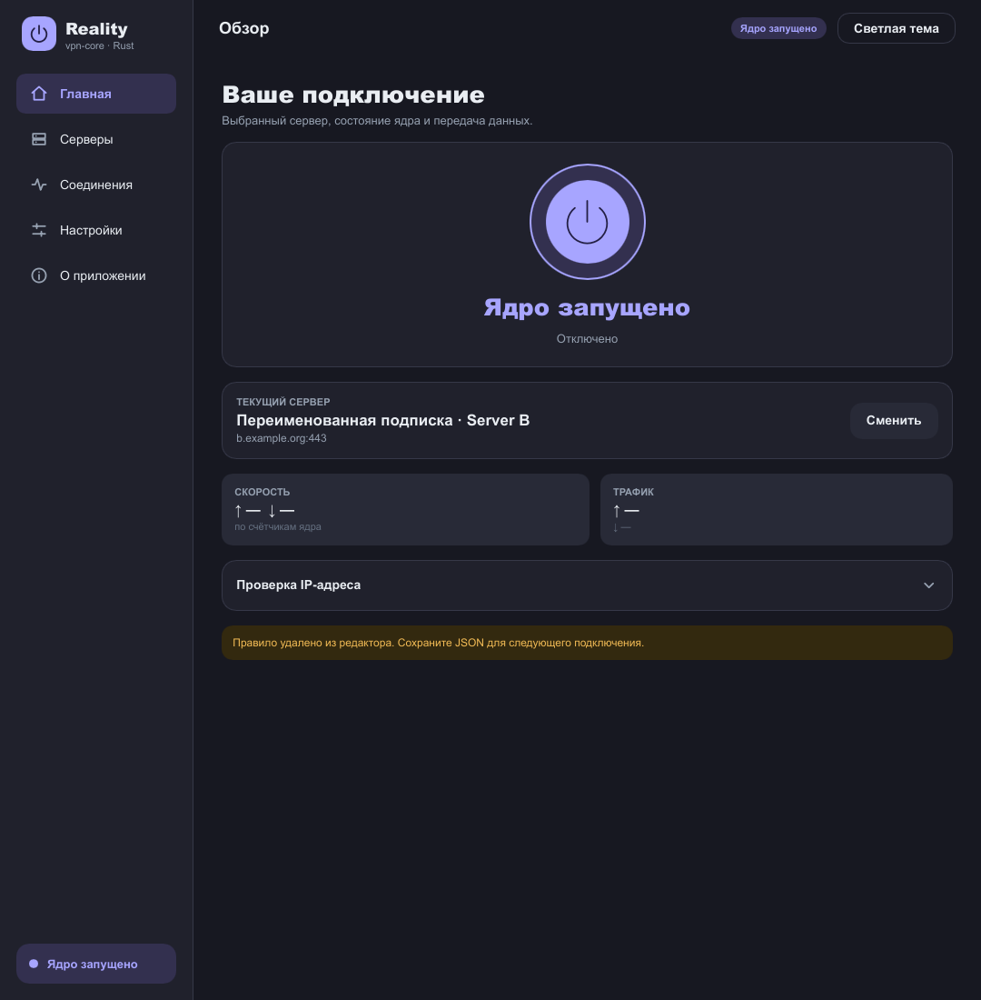
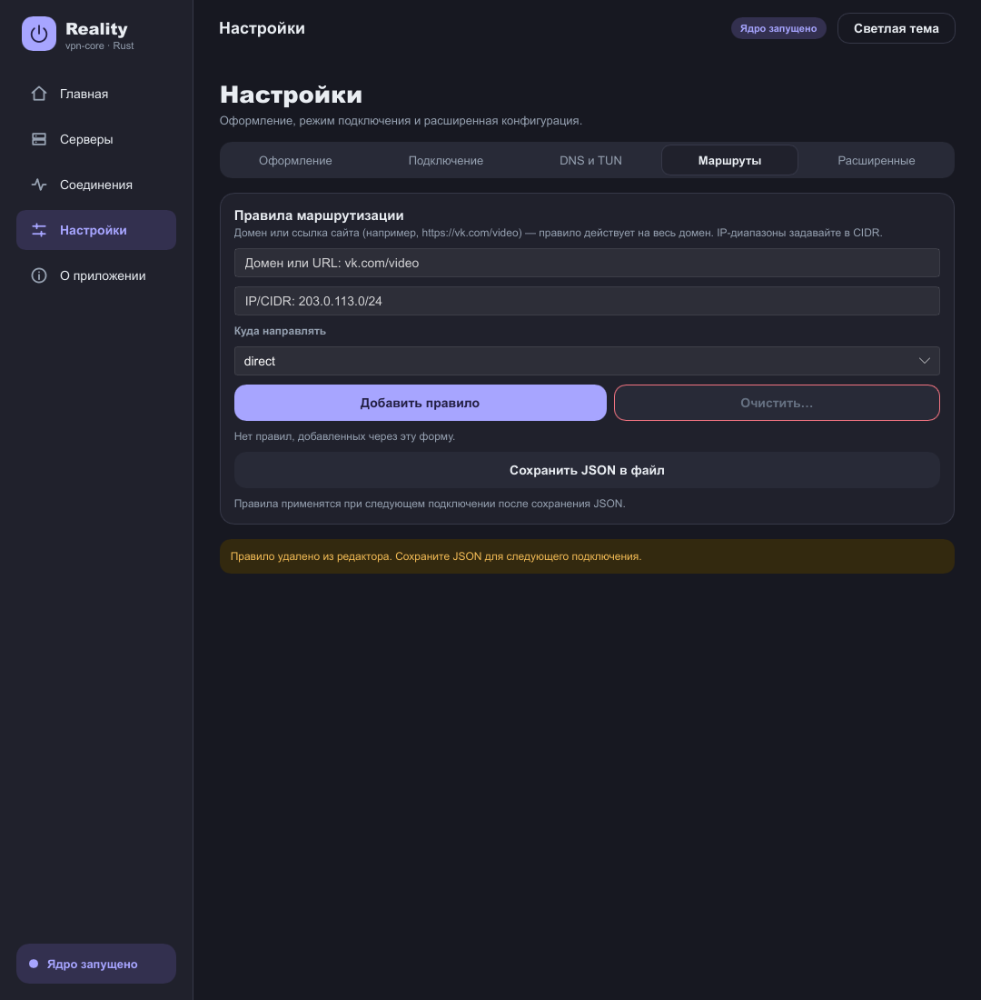
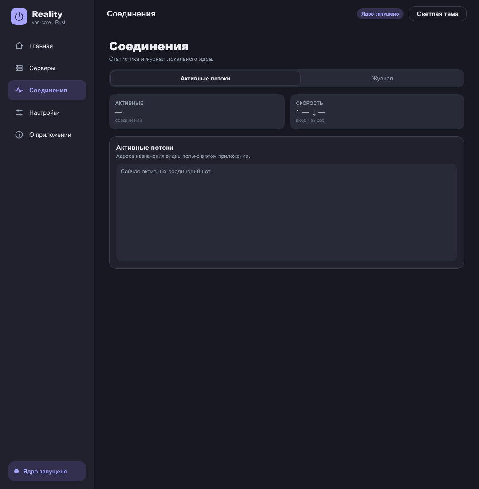
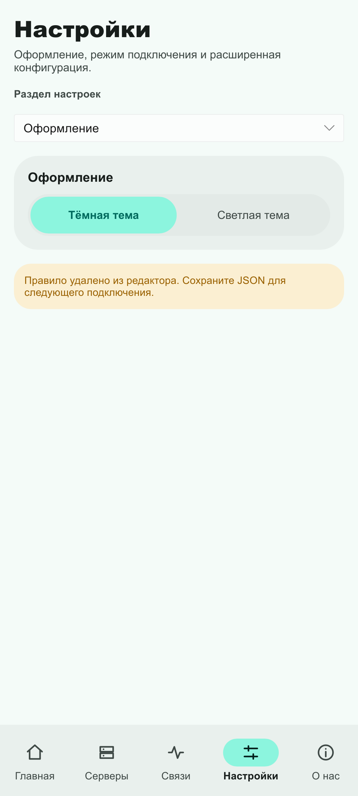
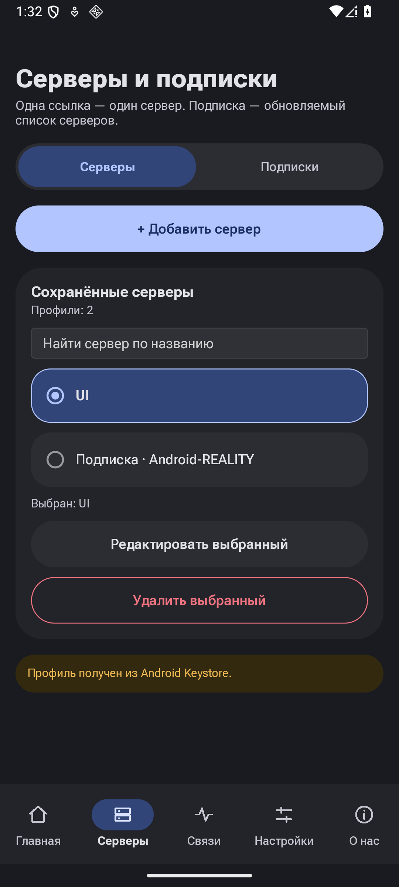
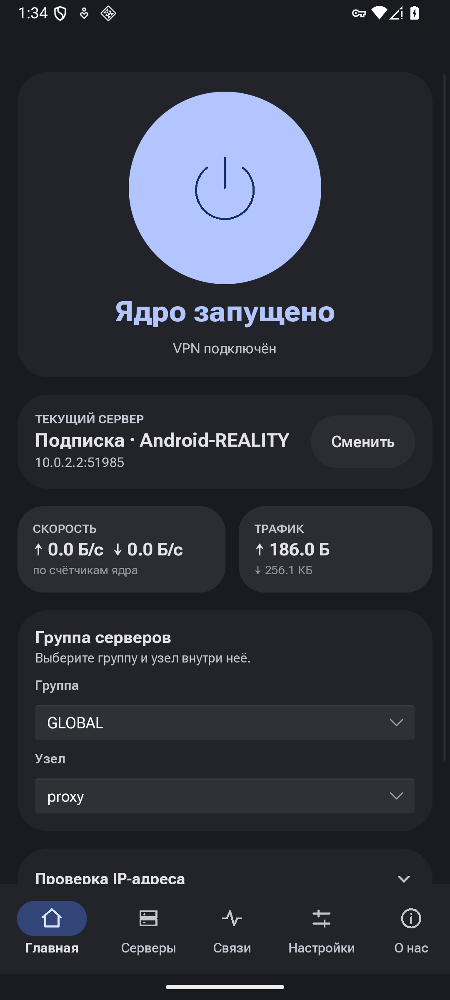
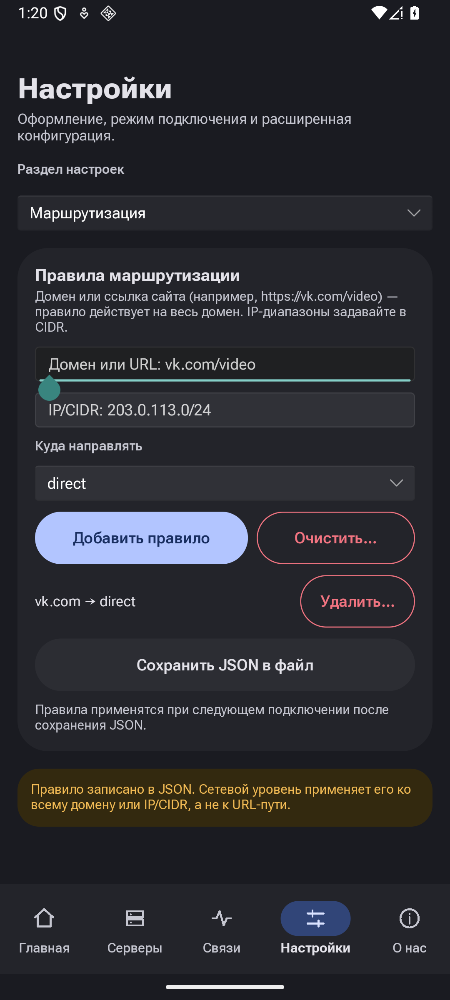

[Русский](UI_REDESIGN.md) | [English](UI_REDESIGN.en.md)

# Reality Client complete UI redesign: 2026-10-11

## Current state

The full package is implemented on the existing `rust-rewrite` branch through PR23.
One active goal
runs sequentially; recurring automation is paused. All files/caches/builds are on D.

127 Android-bridge host tests passed, one opt-in diagnostic ignored. CI-style
Clippy, Windows GNU build, Android ARM64 build and Kotlin unit tests passed.
The matrix covers all screens/settings categories in both themes at 360/412/600px,
landscape and font scale 1.3. Settings-form captures have been inspected; the
expanded editor and confirmation-state audit is recorded in the verification report.
Windows native Tab/Enter/Space and visible focus were exercised in a separate profile.

Our Android16 emulator exercised GUI VLESS/HTTPS import, REALITY/Vision,
cutout/system-bar/IME insets, rotation and Activity recreation, app-filter file
saving and routing addition/removal with confirmation. Latest APK SHA256:
`389527b6e20c2de2a59f5cf3289c54222d78577f1fcdfb1b667ffc193d88bd70`.
Payload: HTTP 200, 262144 bytes, SHA256
`2312394bd99545d9de131c24efb781e765ac1aec243f2ed9347597a793a415e9`.
Disconnect makes the lab endpoint unreachable; reconnect receives the payload again.
Detailed evidence and limitations: [UI_VERIFICATION.md](UI_VERIFICATION.md).

Fixed active-server display after Activity recreation, JSON validation overwriting
the saved configuration, and Android diagnostics reading the edited draft instead
of the active proxy. Exact-head CI and merge/main CI remain pending.
Releases are a separate task. Happ and Windows networking were unchanged.

## Design reference and implementation

[Clash Verge Rev](https://github.com/clash-verge-rev/clash-verge-rev) informs
navigation and profile organization. Its license is GPL-3.0; this project is
GPL-3.0-or-later. No upstream React/TypeScript code, logos or assets were copied.
The adaptation uses the existing Rust/Slint application, with Material You on Android.

## Ten-stage work plan

1. Audit every control against its Rust callback, persistence and pinned-core
   capabilities on Windows/Linux/Android. Never invent latency, countries or IPs.
2. Implement shared adaptive components, tonal surfaces, typography, fields,
   accessible names, Tab/Enter/Space and visible focus; retain Android safe insets.
3. Dashboard: honest session state, selected versus connected endpoint, mode,
   actual speed/traffic, clearly labelled IP diagnostics.
4. Servers: search preserving original indices/identities, select/edit/delete.
   Subscriptions: separate HTTPS import, refresh/rename/delete, loading and errors;
   independent drafts and atomic updates must preserve the active session.
5. Connections: separate actual flows and logs, counters, readable long endpoints
   and empty states. Never expose subscription credentials in logs.
6. Settings: appearance, connection, DNS/TUN, routing, advanced JSON and recovery.
   Explain unavailable platform features and report saving success/failure.
7. Routing: domain/URL and IP/CIDR, available direct/proxy/blocked exits,
   managed-rule deletion with confirmation and preservation of external rules.
   Android app selection/package IDs; URL paths are not separate HTTP rules.
8. About: build-derived version, author, real repository action, license/platforms.
9. Verify all screens/categories in both themes, 360/412/600px, landscape, large
   text, empty/error/loading states, keyboard focus, clipboard import/edit/cancel,
   and selection/session preservation. Use isolated Windows GUI and Android16.
10. Update bilingual PLAN/STATUS and evidence. Push through open PR23; merge only
    after exact-head Windows/Linux/Android checks are green; verify merge/main CI.

## Evidence boundaries

Software renders are distinct from native Windows/Android captures. A saved app
filter does not prove actual Chrome traffic filtering. No physical phone,
foreign-IP, UDP/DNS or multi-node-selector result is claimed. Files/caches stay
on `D:/reality-client-work`; host VPN/proxy/DNS/routes/security stay unchanged.

## Own visual references

Gallery refreshed after the complete PR23 redesign (11 October 2026).
Desktop home, routing, connections and light mobile settings use Slint software renders of the final UI with synthetic data. Android images are actual captures from our own Android 16 emulator; they are not third-party assets or traffic proof.

